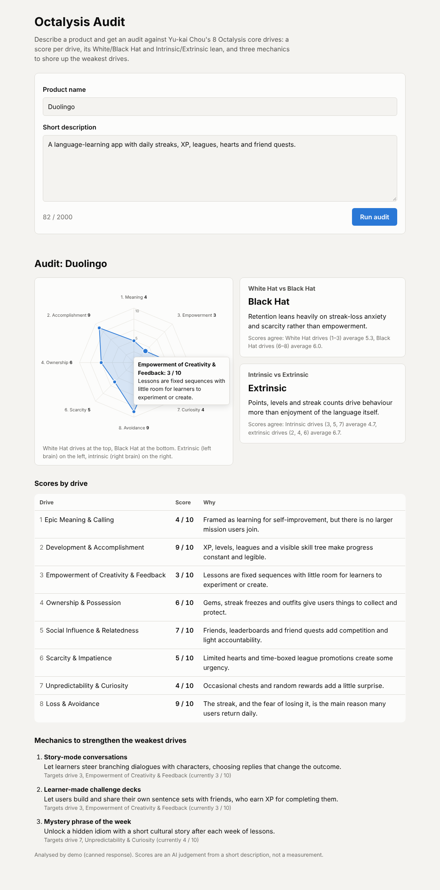

# Octalysis Audit

Paste a product name and a short description. The tool asks Claude to audit it against
[Yu-kai Chou's Octalysis framework](https://yukaichou.com/)
and shows:

- a **0–10 score for each of the 8 core drives**, with a one-sentence justification
- an **octagon radar chart** of the scores, laid out like Chou's diagram (White Hat at the top,
  Black Hat at the bottom, extrinsic on the left, intrinsic on the right)
- whether the product leans **White Hat or Black Hat**, and **Intrinsic or Extrinsic**, with the
  model's reasoning next to averages computed from its own scores, so you can see if they disagree
- **3 concrete mechanics** to strengthen the weakest drives



## How to run it

You need Node.js 20.12 or newer and an Anthropic API key.

```bash
npm install
cp .env.example .env      # then paste your key into .env
npm start                 # http://localhost:3000
```

`.env` is git-ignored, so your key stays on your machine. It's only read by the server. The
browser never sees it.

Optional settings in `.env`:

| Variable | Default | What it does |
|---|---|---|
| `ANTHROPIC_MODEL` | `claude-sonnet-5-5` | Claude model to use, e.g. `claude-opus-5-5` for deeper analysis |
| `PORT` | `3000` | Port the server listens on |

### Try it without a key

```bash
npm run demo
```

This runs the same app with a canned response instead of calling Claude, so you can see the UI.
Use a product name containing `malformed` or `badschema` to see the error states.

### Tests

```bash
npm test
```

The tests use Node's built-in test runner and a stubbed Claude client. They don't call the API
and need no key. They cover the validator, input checks, refusals, truncated answers, and
malformed or out-of-spec model output.

## How it works

```
public/index.html, app.js, style.css   One page: form, results, hand-drawn SVG radar chart
server.js                              Loads .env, creates the Anthropic client, starts Express
lib/app.js                             Routes: GET /api/config, POST /api/audit
lib/audit.js                           Input checks, the Claude API call, error mapping
lib/prompt.js                          System prompt and the JSON schema for the answer
lib/validate.js                        Strict validation of the model's JSON
lib/drives.js                          The 8 drives and Chou's White/Black Hat, left/right brain groups
```

1. The browser posts `{ name, description }` to `/api/audit`.
2. The server checks the input: a name of up to 100 characters and a description of 20 to 2,000 characters.
3. It calls Claude with **structured outputs** (`output_config.format` with a JSON schema), so
   the answer must have the right shape.
4. The schema can't express everything (score ranges, "exactly 8 drives", "exactly 3 mechanics"),
   so `lib/validate.js` checks the parsed JSON strictly. If parsing or validation fails, the page
   shows an error listing what was wrong and **nothing from that answer is displayed**.
5. Refusals (`stop_reason: "refusal"`) and truncated answers (`max_tokens`) get their own clear
   errors. The request opts into server-side refusal fallbacks (`fallbacks: "default"`), so if a
   safety classifier declines, the API retries on Anthropic's recommended fallback model first.

### Why Node

The page and the chart are JavaScript anyway, so a Node backend keeps the project to one
language. The official `@anthropic-ai/sdk` package is first-class, and setup is just
`npm install && npm start`, with no virtualenv. There are two dependencies: Express and the SDK.

## Known limitations

- **It's a judgement, not a measurement.** Scores come from a short description, not from using
  the product. Two runs on the same input can differ by a point or two, and a vague description
  produces vague scores.
- **The model only knows what you tell it**, plus whatever it already knows about well-known
  products. For an unreleased product, it scores only the description.
- **White/Black Hat and Intrinsic/Extrinsic are binary.** A balanced product is still forced to
  one side. The computed averages under each verdict show how close the call was.
- **Mechanics aren't checked against the scores.** The prompt asks for mechanics that target the
  weakest drives, and the page shows each target drive's score, but the validator doesn't
  reject a mechanic aimed at a strong drive.
- **Local use only.** There's no authentication, rate limiting or cost cap. Anyone who can reach
  the server can spend your API credits, so don't expose it to the internet as-is.
- **No history.** Audits aren't saved. Refresh the page and they're gone.
- **Latency.** Each audit is one non-streaming API call, which can take tens of seconds, with no
  progress indicator beyond a status message.
- **English only**, for the prompt and the UI.
